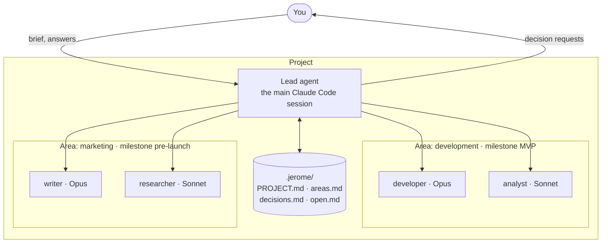

<p align="center">
  
</p>

# Jérôme

**Your projects keep moving while you are away, on the Claude subscription you already pay for.**

Jérôme turns Claude Code into the lead of each of your projects. A project is a product or an initiative, not only code: development, marketing, research. The lead agent keeps the project's state in plain files, gives the work to a small team of agents, works with you in your sessions and on its own on a schedule, and asks you only what is yours to decide. It runs on your Mac, and nothing of your work leaves it.

The name is a nod to Saint Jerome, patron saint of translators: the lead agent translates ideas into tasks.

> **Status: early development.** Everything below is in place and used every day on real projects, on one Mac. It has not yet been tried on a clean machine. See the [roadmap](docs/roadmap.md).

## What it does for you

- **Picks up where you left off.** Each project remembers its goal, its decisions, what is open and what was done, in files you can read. A new session knows all of it in a few thousand tokens, without you explaining anything again.
- **Works while you do something else.** At the times you choose, or whenever the week's quota would otherwise go unused, it takes one task, does it on a branch, checks it with the tests, merges it and writes one line about it.
- **Asks, and does not guess, when it matters.** A choice that costs money, cannot be undone or goes outside the project becomes a question with options and a recommendation. It arrives on your phone, and one tap answers it. Smaller choices it makes itself, and lists them for you to confirm.
- **Stays inside the lines.** It never pushes, deploys, publishes or sends email. Those are drafts for you, enforced by Claude Code's permission rules and not by a promise in a prompt. For a project where you want it, you can [unlock the push](docs/commands/rules.md): Jérôme asks on your phone, and pushes on your yes.

## Why it is different

Most ways of running AI agents on your projects ask you to choose between doing everything in a chat yourself, paying per token for agents that run in someone else's cloud, or a script that starts the model on a timer and hopes for the best. Jérôme makes other choices:

- **The subscription, not an API key.** The cost is the one you already pay. The quota of the week, lost if unused, is spent on your backlog instead, while a reserve stays yours.
- **On your Mac, where your code and your login already are.** Code, prompts, transcripts and credentials never leave the machine. Nothing on it listens on the internet.
- **Small context by design.** A session starts at about 12k tokens instead of 29k. A cheap check decides whether there is work before the expensive model starts, and usage is counted by hooks, outside the model.
- **State in files, not in a service.** Decisions, open items and the brief are Markdown in the repository: versioned, readable, and yours to edit.
- **Nothing fails silently.** No run is skipped without a reason, half-done work is resumed before anything new, and every run is checked when it ends. A problem reaches you as one sentence with one button.
- **Built on Claude Code, not beside it.** It uses Claude Code's own subagents, skills, hooks and permissions, and lists what it depends on, so a Claude Code update does not break it unseen.

Why each choice was made, what was set aside, and why one Mac comes first and a coordinator for several Macs comes after: [docs/why.md](docs/why.md).

## How it works



You start from a brief. The lead agent keeps the project's state, proposes a team of agents for each **area**, and works towards each area's current **milestone**, one task at a time: with you in your sessions, and on its own in scheduled runs called **heartbeats**. When something is yours to decide, it leaves a **decision request** and goes on with what does not depend on it.

## Requirements

- macOS (scheduled runs use launchd; the rest also works on Linux)
- Node.js 24 or later
- git
- Claude Code, logged in with a Claude subscription (`claude auth login`), not an API key

If Node.js comes from a version manager such as nvm, see [docs/heartbeat.md](docs/heartbeat.md#how-it-is-started): scheduled jobs do not load your shell, and `jerome doctor` tells you when a path they use has changed.

## Install

```sh
npm install -g github:meltinbitfarm/jerome && jerome version
```

The same command updates Jérôme. Its last line, such as `jerome 0.12.2`, is the version now installed.

## Using it

Jérôme has many commands, but day to day you use a handful. Here is what to run in each situation.

### A new project

Hold the briefing wherever the idea comes to you. **On your phone**, in any chat app: copy the briefing instructions, paste them as the first message, and describe the idea, even in long dictated messages. The model asks one question at a time, and when you say "save the brief" it writes the brief. Then on the Mac:

```sh
jerome prompt | pbcopy                      # the briefing instructions, to paste into the chat
pbpaste | jerome new my-project --from-file -   # once the brief is copied from the chat
cd my-project && claude
```

**Or in Claude Code** from the start:

```sh
jerome new my-project
cd my-project && claude                     # then: "let's do the briefing"
```

In the first session, ask the lead agent to **propose the team**. It suggests the smallest set of agents for each area's milestone, each on the model suited to its work, and creates them once you confirm. [docs/guide.md](docs/guide.md) follows one project like this from the idea to its second area.

### A project you already have

```sh
cd my-app
jerome init                                 # adds Jérôme's files, overwrites nothing of yours
claude                                      # then: "let's do the briefing"
```

The lead agent first lists the instructions of the project that conflict with Jérôme's, for you to settle. Then it reads the code and the README rather than asking you what they already say, and asks only what is missing. Your `CLAUDE.md` and `docs/` stay as they are.

### Working with the lead agent

Open `claude` in the project folder and talk in your language, as with Claude Code. The difference is what happens around it:

- **Leaving and coming back.** Close the session whenever you like. Everything that matters is already in `.jerome/`. The next `claude` opens with what happened meanwhile: alerts first, then the questions waiting for you, the choices it made on its own for you to confirm, and the notes you sent from your phone. A fresh session is cheaper than resuming a long one, and loses nothing.
- **Your session comes first.** While you are working in a project, no heartbeat starts there. Twenty minutes after your last message, the project is free again, even if you left the session open.
- **Answers and decisions stick.** What you decide is written in `decisions.md` with its reason, and is not reopened without a concrete problem.

### Letting it work on its own

Three steps, once:

```sh
jerome telegram setup        # connect a Telegram bot: questions and problems reach your phone
jerome schedule daily --at 09:00   # in a project: one run every day at 09:00
jerome governor on           # on this Mac: extra runs while the week's quota is behind its pace
jerome governor add          # in each project that may get those extra runs
```

`telegram setup` also installs the **watchdog**, the machine's job that runs every minute. It keeps the Telegram bridge listening, closes runs whose process died, tells you about runs that should have started and did not, and runs the governor. If you skip Telegram, install it yourself with `jerome watchdog install`.

You do not need both kinds of runs. A project can have only fixed times, only governor runs, or both. For several runs a day, or different work at different times, such as "07:30: import yesterday's results", ask the lead agent to set up **slots**, then run `jerome heartbeat install`. See [docs/heartbeat.md](docs/heartbeat.md) and [docs/quota-governor.md](docs/quota-governor.md).

Every run has a cap on tokens and turns, and runs pause by themselves when a usage limit you set is reached: see [`jerome limits`](docs/commands/limits.md).

### From your phone

With Telegram set up, you get only what needs you, from every project:

- a **question** with its options as buttons: one tap answers it, or reply to the message with your own words;
- a **problem** that lasts, as one sentence with buttons that fix it from afar: allow a tool, trust a folder, commit your changes, try again with a bigger budget, skip that work;
- a warning when the week's quota is running out too fast;
- in a project where you [unlocked the push](docs/commands/rules.md), the main branch's new commits, with a button to push them.

You can also send a project a **note**, such as `#my-project the pricing page should mention the free plan`. It is read at the next run or session. `/status` lists what waits for you everywhere. The bridge has no model behind it: it costs no tokens, and what you write is always data, never an instruction. The [Director's dashboard](docs/director.md#acting-from-the-dashboard), if you use one, does the same from a browser. To talk to the lead agent itself from the phone, use Claude Code's Remote Control on a session. See [docs/telegram.md](docs/telegram.md).

### Keeping an eye on things

All of these are free: they read files and the database, not the model.

```sh
jerome projects              # every project on this Mac, from any folder: what needs you first
jerome state                 # one project in a few lines: usage, areas, runs, open questions
jerome view                  # the same in the browser: what it is doing now, what is left, what was done
jerome digest                # what happened this week
jerome heartbeat status      # a project's runs, its jobs and any problem
```

### Several Macs

If your projects are spread over more than one Mac on the same Claude account, **Jérôme Director** coordinates them from a server of yours, reached over your VPN, with a dashboard for the phone. It is optional: each Mac works fully on its own. See [docs/director.md](docs/director.md).

### Keeping up to date

```sh
npm install -g github:meltinbitfarm/jerome && jerome version
jerome update                # in each project: the lead agent's instructions and skills, to the new version
jerome doctor                # if something looks wrong: checks the setup and fixes what it can
```

## The commands you will use

| Command | When |
|---|---|
| [`jerome new`](docs/commands/new.md), [`jerome init`](docs/commands/init.md) | Start a project, or bring Jérôme into one you have |
| [`jerome prompt`](docs/commands/prompt.md) | Hold the briefing in any chat |
| [`jerome telegram setup`](docs/commands/telegram.md) | Once per Mac: questions and problems on your phone |
| [`jerome schedule`](docs/commands/schedule.md), [`jerome heartbeat install`](docs/commands/heartbeat.md) | Runs at fixed times |
| [`jerome governor`](docs/commands/governor.md) | Runs that use the week's quota before it is lost |
| [`jerome projects`](docs/commands/projects.md), [`jerome state`](docs/commands/state.md), [`jerome view`](docs/commands/view.md) | See where things stand |
| [`jerome update`](docs/commands/update.md), [`jerome doctor`](docs/commands/doctor.md), [`jerome version`](docs/commands/version.md) | Keep it up to date and healthy |

The rest, about twenty more, are for particular cases or are run by Claude Code and launchd rather than by you: [all the commands](docs/commands/README.md).

## Learn more

- [Why Jérôme works this way](docs/why.md): the choices behind it, and what was set aside
- [A project from start to finish](docs/guide.md), step by step
- [Settings](docs/configuration.md): every value, where it lives and how to change it
- [The lead agent](docs/lead-agent.md), [agents](docs/agents.md), [areas and milestones](docs/areas.md), [the briefing](docs/project-brief.md)
- [Heartbeats](docs/heartbeat.md), [limits](docs/limits.md), [the quota governor](docs/quota-governor.md), [Telegram](docs/telegram.md), [the Director](docs/director.md)
- [The lean profile](docs/lean-profile.md), [project layout](docs/project-layout.md), [usage data](docs/usage-data.md), [the database](docs/database.md)

## Repository layout

The root of this repository holds Jérôme's own development files. Only `template/` ends up in projects. See [docs/repository-layout.md](docs/repository-layout.md).

## License

[MIT](LICENSE)
