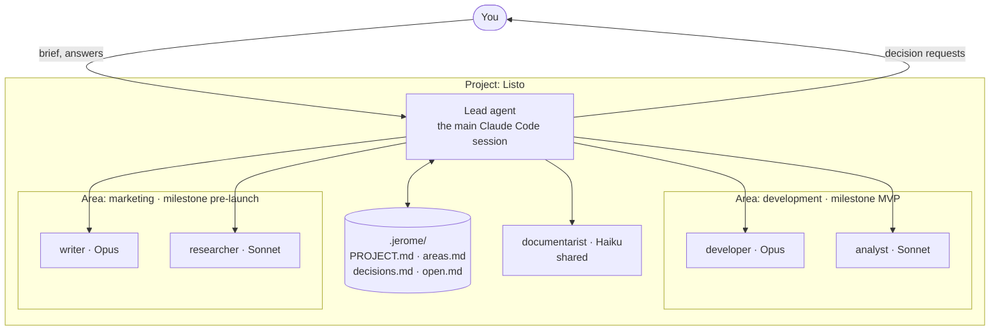
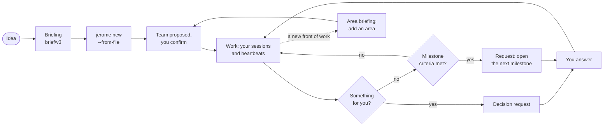

# Using Jérôme, from the idea onwards

This guide follows one project from start to finish: an idea, its brief, the project and its team, the work done with you and without you, the decisions it leaves for you, and the next steps once a milestone is reached. The example is **Listo**, a small web app to share shopping lists, which opens a marketing area once its MVP is out.

## The idea in one paragraph

A Jérôme project is a product or an initiative, not just code. In each project, the main Claude Code session becomes the **lead agent**: it keeps the project's state, splits the work and gives it to **agents**, each on the model that suits its kind of work. The work is organised in **areas** (development, marketing, research, support, any other), and each area moves through **milestones** with criteria you can check. The lead agent works with you in your sessions, and on its own in scheduled **heartbeats**. When something is yours to decide, it leaves a **decision request** and waits. You stay the owner: nothing is published, deployed, pushed, bought or sent without you.

| Word | What it is |
|---|---|
| Brief | The project's starting document: goal, constraints, decisions, open questions, areas |
| Lead agent | The main Claude Code session in the project folder, with Jérôme's instructions |
| Area | A front of work, with a goal, a folder, its agents, a pace and a priority |
| Milestone | An area's current stage, such as MVP or beta, with the criteria that tell it is reached |
| Agent | A subagent in `.claude/agents/`: developer, writer, researcher, analyst, clerk, documentarist |
| Heartbeat | A scheduled run of the lead agent without you, on one task in one area |
| Decision request | A question the lead agent leaves for you, with options and its recommendation |

## How a project is built



The lead agent is the only one that talks to you and the only one that writes the project's state in `.jerome/`. Agents get a task with the paths they need, do it on a branch, and reply in a few lines; details go to files. See [lead-agent.md](lead-agent.md), [agents.md](agents.md) and [areas.md](areas.md).

## The life of a project



The rest of this guide walks through it with Listo.

## 1. From the idea to the brief

You can hold the briefing anywhere. On your phone, paste the output of `jerome prompt` into a chat as the first message and describe the idea, even in long dictated messages. In Claude Code, inside a project, the `project-brief` skill does the same. The model asks one question at a time, questions what costs tokens or adds complexity, and records each decision with its reason. When you say "save the brief", it first lists the proposals you never confirmed, then writes the brief in the `brief/v3` format.

For Listo, the brief has one area for now:

```markdown
---
format: brief/v3
name: Listo
slug: listo
status: ready
created: 2026-11-02
source: mobile
---

## Goal
A web app where a household shares its shopping lists, live, from any phone.

## Constraints
- V1: Laravel and Postgres, hosted in the EU.

## Decisions
- D1: Sign-up by email link, no passwords — fewer support requests.

## Agent limits
- L1: No sending, publishing, deploying, pushing, purchases or emails: drafts and proposals only (default).

## Open questions
- Q1: Hosting provider.

## Parked
- P1: Native apps — after the beta.

## Out of scope
- Recipes, prices.

## Success
- Ten households use it every week.

## Areas
### development
- Goal: A web app a household can sign up to and share a list in.
- Milestone: MVP
- Criteria: sign-up by email link; one shared list that updates live; tests pass; deploy guide ready for the owner
- Folder: .
- Pace: daily
- Priority: 1
```

Context, Tools and the other optional sections are left out here for brevity. See [project-brief.md](project-brief.md) for the briefing and the format.

## 2. From the brief to the project

Copy the brief, then:

```
$ pbpaste | jerome new listo --from-file -
✓ Project created in /Users/you/listo
✓ Brief imported into .jerome/: PROJECT.md, scope.md, areas.md, decisions.md, open.md and brief.md
✓ Default limits — permission rules added to .claude/settings.json
…
Ready: cd listo && claude
```

The CLI sorts the brief into the project files at zero tokens: what the lead agent needs at every turn into `PROJECT.md`, the rest into files it reads only when needed, the area into `.jerome/areas.md`. It also sets the lean profile, the permission rules that make the agent limits binding, the hooks that record usage, and the project database. See [`jerome new`](commands/new.md).

Open a session with `claude` and ask the lead agent to propose the team. With the `project-team` skill it proposes, area by area, the smallest team for the current milestone: for Listo's development, a developer on Opus, an analyst on Sonnet for reviews, and the documentarist on Haiku. Nothing is created until you confirm.

## 3. Working together

In your sessions you talk to the lead agent in your language. It reads `areas.md`, `scope.md` and `decisions.md` before choosing or planning work, delegates to the agents, has each task done on a branch, and merges it into `main` itself when the tests pass without conflicts. Decisions you make are recorded in `decisions.md`, one line each with its reason, and are not reopened without a concrete problem.

It asks you only what matters: a choice that cannot be undone, costs money, goes outside the project (publishing, sending, a provider), changes the goal or the scope, or goes against a recorded decision. Every other choice it makes itself, with a sensible default, and notes it in `open.md` as an assumption to confirm, not as a decision:

```
## Assumptions
- A3: shopping list items sorted by aisle, not by insertion — what most list apps do
- A4: a household is limited to 8 members — easy to raise later
```

When you come back, the lead agent puts the open assumptions to you in one block, after any decision requests: "OK" confirms them all, and you correct only those you want otherwise. Confirmed ones become decisions; corrected ones become the correction's decision, and the work is changed to match. Asking does not stop it either: while a question waits for you, it goes on with everything that does not depend on the answer.

To see where things stand, at zero tokens:

```
$ jerome state
listo · state at 2026-11-09 18:02
usage   today 1.2M (in 4k · out 61k · cache read 1.1M · write 52k) ≈$1.10 API · 7d 6.8M ≈$5.90 API
window  5h 23% · 7d 31% (statusline, 17:58) · global limits 70% / 75%
limits  today ≈$1.10/$5 · this week ≈$5.90/$20 API
areas   development MVP 7d 6.8M ≈$5.90 API
agents  7d: main 4.1M · developer 2.2M · analyst 380k · documentarist 120k
runs    last 3: 17:20 interactive done 1.2M · 09:00 heartbeat development done 840k · 08/11 09:00 heartbeat development done 610k
open    no decision requests
```

With a single area, all of the project's usage is that area's. `jerome view` opens the same data in the browser, with each run's delegations. Dollar amounts are API equivalents, a measure of how much of the subscription a project takes, not a bill. See [`jerome state`](commands/state.md) and [`jerome view`](commands/view.md).

## 4. Heartbeats

```sh
jerome schedule daily --at 09:00
```

Every morning, launchd starts a heartbeat. It goes through cheap checks first (no session of yours open, a clean working tree, the setup in order, no limit reached), then leaves out the areas that are paused, waiting for you, or whose pace has not come round. A triage on Haiku, about 5,000 tokens, reads what is left and picks one task in one area, or decides there is nothing to do. Only then does the lead agent start, in a new session with a cap on tokens and turns, does the task on a branch, merges it when the tests pass, and appends one line to `.jerome/digest.md`. `jerome digest` puts a week of those lines together with its figures. See [heartbeat.md](heartbeat.md).

## 5. Decision requests

A heartbeat never asks, since nobody reads it. On Listo, the developer has the app ready to deploy, and the hosting provider is still Q1, so the lead agent opens a request and goes on with the parts of its task that do not depend on it, such as the database migrations and the guide's provider-neutral steps:

```
R2  Deploy guide ready: Fly.io or Render for the EU hosting?
    options         Fly.io / Render
    recommendation  Fly.io: Postgres in Frankfurt, cheaper at this size
```

You get a macOS notification. While R2 is open, the development area still gets work that does not depend on it: the triage leaves the deploy for later and picks another task, and the lead agent is told R2 is already asked, so it does not ask again. Only a milestone request, like R5 below, holds up its whole area until you answer. In your next session the lead agent brings R2 up first; you answer, it records the answer with `jerome request answer 2 "Fly.io"` and the decision in `decisions.md`, and the next heartbeat goes on from there. See [`jerome request`](commands/request.md).

## 6. A milestone is reached

You deploy Listo with the guide. Over the next heartbeats the criteria of the MVP are all met, so the triage makes checking them the task. The lead agent checks each criterion and, rather than looking for more work, proposes the next milestone:

```
R5  development: MVP met (sign-up, live shared list, tests, deploy guide). Open "beta"?
    options         open beta / continue MVP / area briefing
    recommendation  open beta: criteria "invite a second member; offline edits sync; 10 households onboarded"
```

Until you answer, heartbeats give the development area no work, and the other areas go on. Answer "open beta" and the lead agent updates the area's milestone and criteria in `areas.md`, in a heartbeat too, and records `D9: development: MVP done → beta — …`. Answer "area briefing" when the next milestone needs a conversation: in a session, the lead agent asks a few questions and proposes the milestone with its criteria for you to confirm.

## 7. A new area: marketing

With the beta on its way, Listo needs people to try it. In a session:

> Let's add a marketing area: I want a waiting list before the beta.

The lead agent runs the area briefing: what the area must achieve, its first milestone and criteria, where its work goes, how often heartbeats should work on it and how it ranks against development, and any limit of its own. After you confirm, `areas.md` gets a second section:

```markdown
## marketing
- Goal: 200 households on the waiting list before the beta.
- Milestone: pre-launch
- Criteria: landing page drafted in marketing/landing.md; three posts drafted; waiting-list form specified
- Folder: marketing/
- Agents: writer, researcher
- Pace: weekly
- Priority: 2
```

Then, with the `project-team` skill, it proposes the agents the area needs: here a writer on Opus for the landing page and the posts, and a researcher on Sonnet for the audience and the competitors. Once you confirm, they are created and listed in the area. The agent limits still hold: marketing produces drafts, and you publish them.

From now on each heartbeat chooses between the two areas: development first, as it has priority 1, and marketing at most once a week. `jerome state` adds one line, with each area's usage over 7 days:

```
areas   development beta 7d 5.1M ≈$4.20 API · marketing pre-launch 7d 900k ≈$0.95 API · shared 7d 1.3M ≈$1.10 API
```

`shared` is the lead agent's own turns in your sessions, and agents that serve several areas. See [areas.md](areas.md#usage-per-area).

## 8. Keeping it in hand

- **Limits.** Heartbeats pause, at zero tokens, when a subscription window reaches its global limit, or the project's spend today or this week reaches its own; they start again by themselves when the window resets. Your sessions are never blocked: you are warned. See [limits.md](limits.md).
- **Pausing an area.** Set its `Pace` to `paused` (ask the lead agent): heartbeats leave it alone until you change it back.
- **Updates.** `jerome update` brings the template's files, such as the lead agent's instructions and the skills, to the installed version, without touching the project's state or agents.
- **All your projects.** `jerome projects`, from any folder, lists every project on the machine with what needs you first: open requests, a heartbeat that failed, stopped at its cap or is blocked until you act, a scheduled heartbeat that has not run. `jerome projects --view` shows it in the browser, and opens each project's viewer. See [`jerome projects`](commands/projects.md).
- **Checks.** `jerome doctor` checks the setup and restores the lean profile; it also reports what is wrong in `areas.md`.
- **Settings.** Every value above, and the models of the agents and of the lead agent, with where it lives and how to change it: [configuration.md](configuration.md).

## Where to go next

- [configuration.md](configuration.md): every setting, where it lives and how to change it
- [Commands](../README.md#commands), each with its own page
- [areas.md](areas.md): areas, milestones and the area briefing in detail
- [heartbeat.md](heartbeat.md): what a heartbeat does, step by step
- [agents.md](agents.md): the agent catalog and the team
- [lead-agent.md](lead-agent.md): what the lead agent reads, and when
- [project-layout.md](project-layout.md): where Jérôme keeps its files
